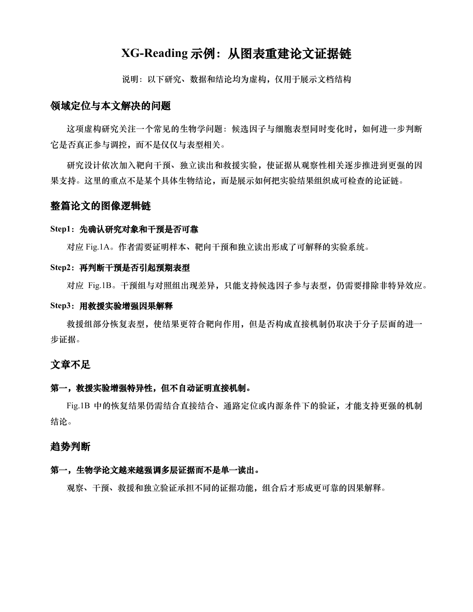
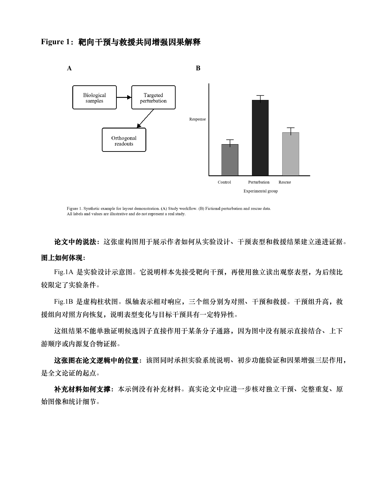

# XG-Reading

XG-Reading是一个面向生命科学论文的深度精读Codex Skill。它以论文图表、实验设计和证据强度为核心，把分散在主文、图注、Methods和Supplementary Information中的信息重建为一条可以检查的论证链，并生成结构统一的中文Word文档。

<p align="center">
  
  
</p>

> 上图来自虚构研究与合成数据，只用于展示输出结构，不对应任何真实论文。

## 核心思路

读懂论文不只是知道作者得出了什么结论，还要知道：

- 结论由哪一张Figure、哪个panel或哪一张Table支持；
- 实验真正测量了什么，作者又进一步推断了什么；
- 对照、重复、统计和补充材料是否足以支撑该推断；
- 相邻图表如何从现象推进到因果、机制或转化结论；
- 哪些结论证据较强，哪些仍然存在替代解释。

主图从PDF文字坐标中单独提取，保留完整图注，并在下一段正文开始前结束裁剪，避免固定截图范围带入无关正文。

XG-Reading先建立论文专属的claim-to-evidence map，再逐图写作，因此不会把图表解读退化成图注翻译。

## 通用，但不牺牲深度

项目使用一套共享的证据判断骨架，同时针对不同生命科学研究调用不同的专业模块：

- 分子与细胞机制；
- 组学、单细胞与计算生物学；
- 免疫学、微生物学与感染；
- 结构生物学与方法开发；
- 生物材料、药物递送、动物研究与临床转化。

每次阅读只选择一个主模块，必要时叠加一个次模块。这样既能适应不同论文，又不会用一套浅层问题清单平均化所有研究。

## 输出内容

生成的Word文档通常包括：

1. 领域问题、研究缺口和本文贡献；
2. 整篇论文的图表逻辑链；
3. 每张主图或主表的逐panel解读；
4. 补充材料对主结论的支持；
5. 文章不足与证据边界；
6. 研究趋势及其科学价值。

文档采用固定的中文学术阅读版式，并在生成后执行结构审计和逐页渲染检查。

## 安装

将`skill/xg-reading`复制到个人Codex Skill目录：

```text
~/.codex/skills/xg-reading
```

重新打开Codex后可显式调用：

```text
Use $xg-reading to deeply read this life-science paper and create a Chinese Word reader.
```

也可以直接使用中文：

```text
请结合主文和补充材料逐图精读这篇论文，梳理论证链、证据强度和局限性，并生成Word文档。
```

## 建议输入

- 主文PDF；
- Supplementary Information；
- Supplementary Movies或可访问的视频文件；
- 用户希望重点理解的问题。

缺少关键材料时，Skill应明确标注证据缺口，而不是根据领域常识补写不存在的数据。

## 准确性说明

XG-Reading用于辅助科研阅读，不替代原始论文、同行评议或研究者本人的判断。AI生成内容可能存在遗漏、误读或结论强度不当。涉及实验条件、样本量、统计方法、机制、疗效和安全性的判断，必须回到原文、完整图注、Methods、Supplementary Information及原始数据核查。

## Repository status

当前仓库尚未选择开源许可证。在没有许可证的情况下，默认保留相关权利。后续如需允许他人复制、修改或分发，可再选择合适的软件许可证。

## English summary

XG-Reading is a depth-preserving Codex Skill for life-science paper reading. It reconstructs claim-to-evidence chains from figures, tables, methods, statistics, and supplementary materials, then produces a structured Chinese DOCX reader. The screenshots above use synthetic data and do not represent a real publication.
